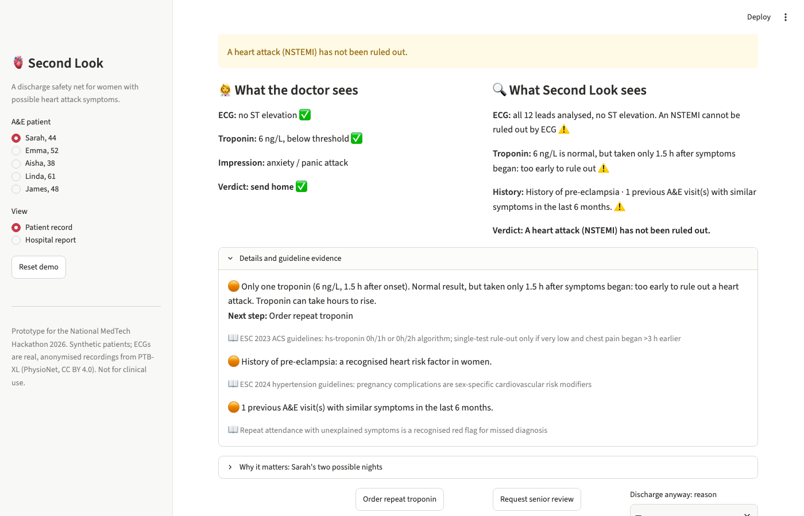
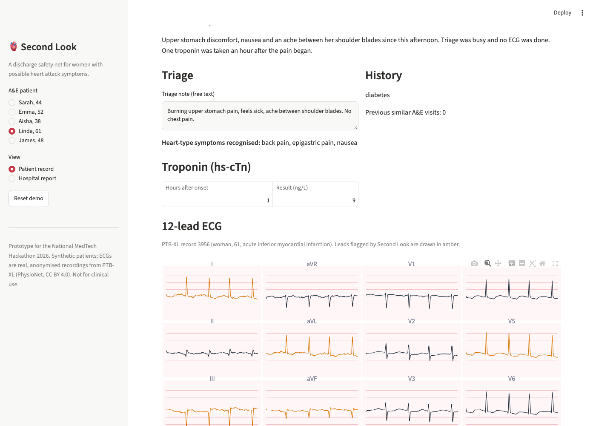

# Second Look

**A discharge safety net for women with possible heart attack symptoms.**

Built at the National MedTech Hackathon, November 2026.

Women having a heart attack are more likely than men to be sent home from A&E with a non-cardiac diagnosis. Common reasons are symptoms that don't look "typical" (nausea, back pain, fatigue), smaller ST elevation on the ECG, and a single troponin taken too early to rule anything out.

Second Look runs at the moment a clinician discharges a patient with a non-cardiac label such as "anxiety" or "indigestion". It checks whether the heart attack work-up is actually complete, and stays silent when it is.



## What it checks

| Check | What fires it |
|---|---|
| **Symptoms** | Free-text triage note mapped to cardiac symptoms, including the ones women report more often (nausea, back or jaw pain, fatigue). Handles negation: "no chest pain" is not a symptom. |
| **Troponin** | No test; a single test taken under 3 h after onset; a rise between tests; any value above the **sex-specific** 99th percentile (16 ng/L for women, 34 ng/L for men). |
| **12-lead ECG** | No ECG; ST elevation meeting STEMI criteria (4th Universal Definition of MI, with the lower V2–V3 threshold for women); **subtle** ST elevation just below those thresholds in contiguous leads; ST depression. |
| **History** | Pre-eclampsia, pregnancy in the last 12 months (SCAD risk), early menopause, diabetes, repeat A&E visits. If there is no record, it asks the clinician four bedside questions instead of assuming "nothing relevant". |

Every warning shows the recommended next step and the guideline behind it. A complete, normal work-up produces no alert, so the tool doesn't add to alarm fatigue.

## Demo patients

Five synthetic A&E patients, each with a real ECG:

| Patient | Scenario | Second Look |
|---|---|---|
| Sarah, 44 | Labelled panic attack; one troponin 1.5 h after onset; history of pre-eclampsia | Fires: troponin too early. Repeat troponin rises 6 → 41 ng/L |
| Linda, 61 | Labelled indigestion; nausea and back pain, no chest pain; no ECG done | Fires: no ECG. The ECG shows subtle inferior ST elevation with lateral depression |
| Aisha, 38 | No medical record available | Asks bedside questions; recent pregnancy raises a SCAD warning |
| Emma, 52 | Reflux, fully worked up | Silent |
| James, 48 | Musculoskeletal pain, fully worked up | Silent |



## ECG analysis

`ecg.py` loads 500 Hz PTB-XL recordings with `wfdb` and:

1. band-pass filters each lead (0.05–40 Hz, zero-phase Butterworth), with the 0.05 Hz corner keeping the ST segment intact
2. detects R peaks in lead II with a Pan-Tompkins style detector (5–15 Hz band-pass, derivative, squaring, moving-window integration)
3. measures ST deviation per lead as the median over beats of the signal at R + 100 ms minus the PR baseline at R − 80 ms
4. applies sex- and age-specific STEMI thresholds by contiguous lead group (inferior, anterior, lateral)

Results on the bundled recordings, compared with the PTB-XL cardiologist labels:

| PTB-XL record | Patient | Label | Second Look ECG finding |
|---|---|---|---|
| 33, 44, 81 | Women, 45–49 | Normal | None |
| 7 | Man, 54 | Normal | None |
| 3956 | Woman, 61 | Acute inferior MI | Subtle ST elevation III, aVF; ST depression I, aVL, V5 |
| 514 | Woman, 61 | Acute inferolateral MI | STEMI criteria II, III, aVF |
| 5329 | Woman, 57 | Acute anteroseptal MI (with LVH) | STEMI criteria V1–V3 |

This is seven records chosen for the demo, not a validation study. Record 3956 is the case the subtle-change band exists for: a confirmed infarct that a STEMI-threshold check alone would not flag. The fixed R-peak offsets are an approximation of the J-point and would need proper delineation for real use.

## Run it

```bash
python3 -m venv .venv
.venv/bin/pip install -r requirements.txt
.venv/bin/streamlit run app.py
```

Tests (rules engine, ECG findings for every patient, and a click-through of the app):

```bash
.venv/bin/pip install pytest
.venv/bin/python -m pytest tests
```

## Project layout

| File | Purpose |
|---|---|
| `app.py` | Streamlit interface: patient record, discharge check, hospital report |
| `rules.py` | Rules engine. All clinical thresholds, symptom phrases and references are at the top of the file |
| `ecg.py` | ECG loading, filtering, R-peak detection and ST measurement |
| `patients.py` | Synthetic demo patients |
| `scripts/pick_records.py` | How the PTB-XL records were selected from `ptbxl_database.csv` |

## Limitations

- **Not a medical device and not for clinical use.** Patients are invented. Troponin thresholds are placeholders based on one assay and must be set for the local lab.
- The rules are a prototype of guideline logic, not a validated decision tool.
- Symptom extraction is keyword-based with simple negation handling.

## Data

ECGs are from **PTB-XL**, licensed under [CC BY 4.0](https://creativecommons.org/licenses/by/4.0/):

> Wagner, P., Strodthoff, N., Bousseljot, R.-D., Kreiseler, D., Lunze, F.I., Samek, W., Schaeffter, T. (2020). PTB-XL, a large publicly available electrocardiography dataset. *Scientific Data*, 7, 154. https://doi.org/10.1038/s41597-020-0495-6

> Goldberger, A., et al. (2000). PhysioBank, PhysioToolkit, and PhysioNet. *Circulation*, 101(23), e215–e220.

## Key references

- Thygesen K. et al. Fourth Universal Definition of Myocardial Infarction (2018)
- Byrne R.A. et al. 2023 ESC Guidelines for the management of acute coronary syndromes
- Shah A.S.V. et al. High sensitivity cardiac troponin and the under-diagnosis of myocardial infarction in women. *BMJ* 2015
- Gupta A. et al. VIRGO study of young adults with acute MI: sex differences in ST elevation. *JAHA* 2018

## Team

Built by a team of engineering and medical students at the National MedTech Hackathon, November 2026.
